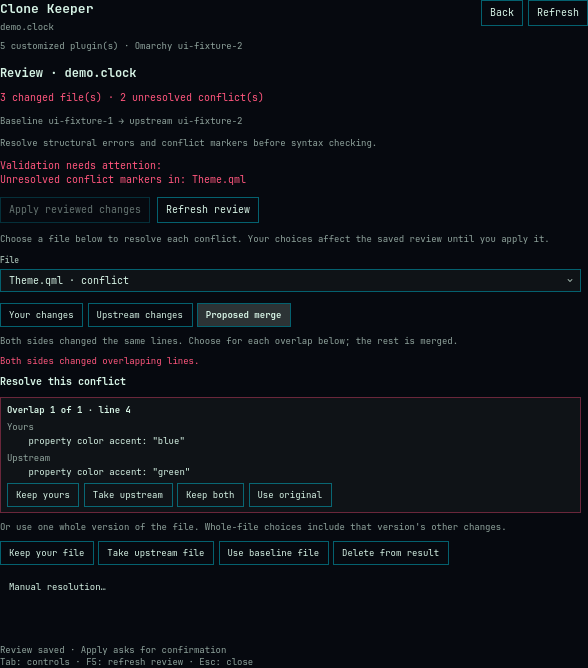

# Clone Keeper

**Your customizations. Upstream improvements.**

Keep customized Omarchy plugins up to date without losing your changes. Clone
Keeper saves their original source, compares your edits with newer built-ins,
and lets you review, resolve and apply the combined result—with recovery and undo.

**Version 0.3.0 · local beta.** The complete maintenance workflow is implemented
in a native panel and a standalone CLI. See [validation](docs/VALIDATION.md) for
tested behavior and the remaining desktop release checks.

## Why it exists

Omarchy clones remember their source ID but do not keep the original source files.
Once your copy and the built-in both change, that missing ancestor makes updates
hard to reconcile. Clone Keeper preserves it:

```text
Saved original ──┬── Your customized clone
                └── Current Omarchy built-in
                            ↓
                   Review → Resolve → Apply
                                      ↕
                                     Undo
```

File contents and modes determine changes. After applying, the baseline advances
to the new upstream source, so your customizations remain distinct on the next
update. Clone identity and Omarchy's source relationship remain intact.

## Features

- Create a disabled clone with its baseline recorded before it can be edited.
- Adopt unchanged clones, or provide a known original for existing customizations.
- Inspect local edits, upstream edits and the proposed result, file by file.
- Merge independent text changes; resolve overlapping, binary and deletion conflicts.
- Save and resume reviews; choose either side, the original, deletion, or edited files.
- Apply the exact reviewed candidate, with stale-input and syntax checks.
- Undo the last applied change, including the previous baseline.
- Recover interrupted creation, apply and undo operations using durable journals.
- Browse clone status, create clones, resolve conflicts and inspect history in the panel.

Both directory manifests and Omarchy's flat `*.manifest.json` sources with
`clonePaths` mappings are supported. There is no background updating or network
fetching. The panel refreshes when opened or requested; middle-click its icon to refresh.
For the live plugin directory it also shows whether each clone is enabled in Omarchy.



Actual panel content in a disposable synthetic fixture. This capture demonstrates
the interface; native bar installation and popup behavior still need the desktop pilot.

## Requirements and installation

Linux, Python 3.11+, and Git are required. The panel needs Omarchy's plugin-capable
Quickshell desktop; it is tested with **Omarchy 4.0.0.alpha** (Qt 6.11). It uses
Omarchy's shared panel components, shell IPC and clone layout, which may still change
before Omarchy 4 is final. Optional **Qt 6 qmllint** checks candidate QML/JavaScript syntax;
reviews report when it is unavailable. No Python packages or sudo are needed.
Apply/undo require filesystem support for Linux `renameat2(RENAME_EXCHANGE)`;
creation uses `RENAME_NOREPLACE`. Unsupported layouts fail before live replacement.

Run directly from this checkout:

```bash
./bin/clone-keeper --help
./bin/clone-keeper status
python scripts/demo.py
```

To install the **committed** local checkout with Omarchy's normal installer:

```bash
omarchy plugin add /absolute/path/to/clone-keeper --enable
```

The plugin ID is `neil.clone-keeper`. Keep the entire repository together: the
panel calls its bundled `bin/clone-keeper` and `clone_keeper/` module. The installer
copies committed Git files; uncommitted development edits are not included.
The installed CLI is `~/.config/omarchy/plugins/neil.clone-keeper/bin/clone-keeper`.
Public installation instructions will use the GitHub URL once published.

Remove through Omarchy:

```bash
omarchy plugin remove neil.clone-keeper
```

Removal leaves your maintained clones and Clone Keeper state intact. Keep the
state directory for future updates and undo. To discard it permanently, first
finish any pending recovery, back it up, then remove the state and staging
directories listed below. There is no automatic history pruning in this beta.

## A complete maintenance cycle

The panel exposes this workflow through **New clone**, **Prepare review**, the
file navigator and conflict choices, **Apply**, and **History / Undo**. New clones
start disabled; enable is a separate action. In the panel, apply, undo, recovery
and enable show a confirmation describing their effect. CLI mutation commands
execute immediately; applying requires the reviewed hash.

The same operations are available from the checkout:

```bash
./bin/clone-keeper clone omarchy.clock --id "$USER.clock"
# Customize the new clone. Enable it when ready:
./bin/clone-keeper enable "$USER.clock"

# After Omarchy updates the built-in:
./bin/clone-keeper prepare "$USER.clock"
```

`prepare` prints a plan ID, candidate hash, file diffs and an editable candidate
directory. Use its plan ID in the following commands (replace `PLAN_ID`):

```bash
./bin/clone-keeper review PLAN_ID
./bin/clone-keeper resolve PLAN_ID --path BarWidget.qml --take local
# Or: --take upstream, base, delete; or --file /path/to/resolved-file
```

For a manual merge, edit the file inside the printed candidate directory and
accept it with `resolve PLAN_ID --path BarWidget.qml --take edited`. Re-review
after every change. Conflict markers and unresolved choices prevent applying.
For file/directory collisions, select the entire conflicting path family.

Apply using the **latest reviewed candidate hash**, replacing the placeholders:

```bash
./bin/clone-keeper apply PLAN_ID --expect CANDIDATE_HASH
./bin/clone-keeper history "$USER.clock"
./bin/clone-keeper undo "$USER.clock"
```

JSON clients can also pass `--expect-plan PLAN_HASH` to bind the saved plan metadata;
the panel supplies both hashes. Apply refuses changes to your clone, upstream,
baseline or reviewed candidate. Undo refuses edits made after apply. If an
operation is interrupted, inspect `status`, then run:

```bash
./bin/clone-keeper recover "$USER.clock"
```

Recovery finishes the interrupted operation; it is not a generic reset. Unknown
edits or damaged backups stop recovery and are preserved for inspection.

Changing an installed clone makes Omarchy reload its plugins, including Clone
Keeper, which closes the panel. The panel therefore runs create, enable, apply, undo
and recovery with `--detach`: the work continues in its own session even though the
panel's helper process is stopped, and records its outcome. Reopen the panel to see
the result; changes stay paused while a detached operation is still running. CLI
users can pass `--detach` too; `status` then lists the outcome until
`clone-keeper dismiss REQUEST_ID` removes it. A failed shell refresh is reported
separately from a successfully saved transaction.

## Existing clones and missing ancestry

For a clone still identical to its current source, apart from generated identity:

```bash
./bin/clone-keeper track "$USER.clock"
```

For an already customized clone, supply the **actual original** from when it was
cloned, as a standalone source directory with its original `manifest.json` and ID:

```bash
./bin/clone-keeper track "$USER.clock" --baseline /path/to/original-clock
```

Paths may start with `~/`; the panel accepts only absolute or `~/` paths.
Historical flat sources must be materialized into their original clone layout.
This records user-supplied ancestry; Clone Keeper cannot prove it is historically
correct. Without a trustworthy original, keep the clone untracked. Repeated
`track` calls never overwrite an existing baseline.

For inspection without saving a plan, use `preview CLONE_ID`.
`export CLONE_ID --output /new/path` writes a conflict-free, structurally valid
candidate outside managed trees; it neither installs it nor advances the baseline.
Use a saved review for the additional QML syntax check.

## Storage and boundaries

| Location | Purpose |
| --- | --- |
| `$OMARCHY_PATH/shell/plugins` (default `/usr/share/omarchy/shell/plugins`) | Read built-in sources |
| `~/.config/omarchy/plugins` | Read clones; create/apply/undo change an explicitly selected clone |
| `$XDG_STATE_HOME/clone-keeper` (default `~/.local/state/clone-keeper`) | Baselines, saved plans, transaction backups, detached-operation outcomes and locks |
| `~/.config/omarchy/.clone-keeper-staging` | Whole clone directories retained by transactions |
| `<state>/.staging` | Baseline directories retained by transactions |

Snapshots may contain private customizations. State is local, and no telemetry
or plugin code execution occurs during inspection. Explicit enable uses supported
shell IPC to update shell configuration; Clone Keeper does not directly rewrite it.
Completed backups and staging trees remain until deliberately removed. Saved
reviews are cleaned up: preparing again replaces an untouched review of the same
inputs, and each apply removes reviews prepared against baselines older than the
one it replaced (undo can make that one applicable again).

Symlinks and special files are rejected. Comparisons ignore `.git`; applying to a
clone containing Git metadata is refused. Apply also refuses hardlinks, special
file permission bits, xattrs and ACLs it cannot preserve. Ordinary file and directory
modes, empty directories, binary files and exact pre-apply manifest bytes are
preserved for undo. Apply keeps your clone's manifest key order and indentation. Ownership and timestamps are not recorded or restored.
Initial limits: 3,000 files, 10 MiB per file, 50 MiB per tree.

Override roots for isolated testing, before the subcommand:

```bash
./bin/clone-keeper --omarchy-path /tmp/example/omarchy \
  --plugins-dir /tmp/example/plugins --state-dir /tmp/example/state status --json
```

Custom plugin roots never issue shell mutations. The source-version label is
diagnostic context; hashes establish whether files changed. A valid manifest,
clean merge and successful syntax check still require testing the plugin's actual
behavior. See [the transaction design](docs/DESIGN.md).

## Development

```bash
python -m unittest discover -s tests -v
python scripts/demo.py
scripts/check-ui.sh
```

The demo completes create → review → apply → undo in temporary directories.
Tests cover stale reviews, conflicts, metadata preservation and simulated crashes.
CI targets Python 3.11 and 3.14. See [validation](docs/VALIDATION.md),
[release preparation](docs/RELEASE.md) and [the roadmap](docs/ROADMAP.md).

MIT licensed. Independent community project; not an official Omarchy component.
